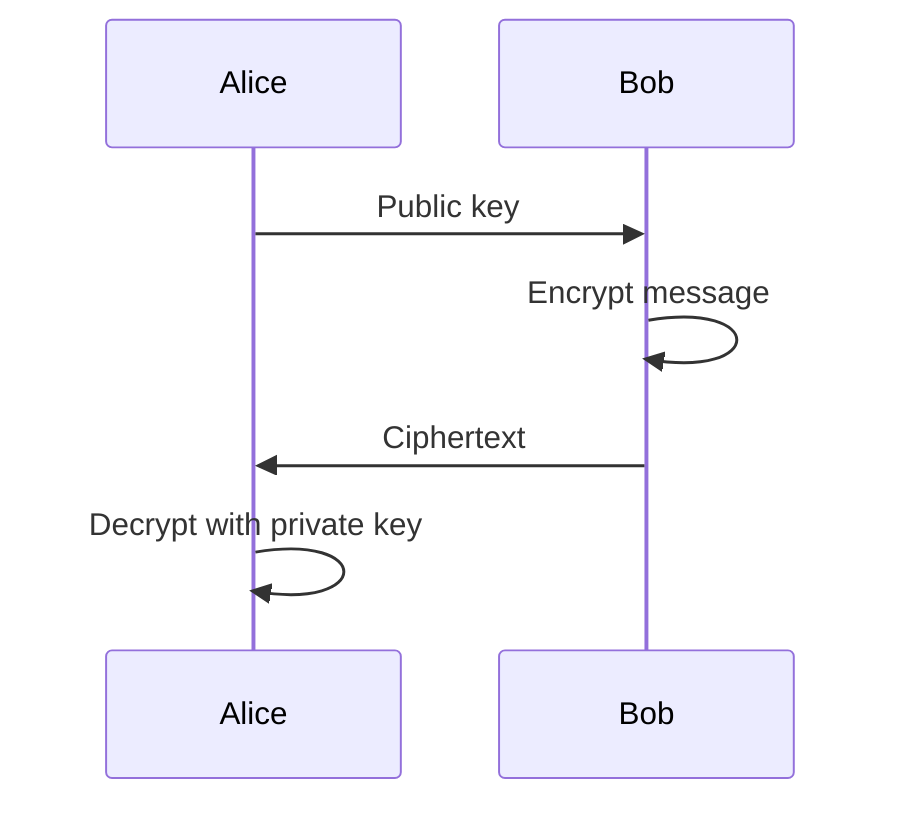
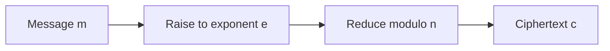
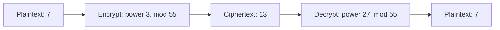

# Understanding RSA From First Principles

RSA is built from familiar mathematical operations: multiplication, powers, and division with remainders. None of those operations is especially mysterious on its own. The interesting part is how RSA combines them to let someone publish an encryption key without also giving away the ability to decrypt messages.

There is a catch, though. The underlying RSA calculation is not a complete, secure encryption system by itself. Used incorrectly, it can expose a message even when the key contains enormous numbers.

To see both sides of RSA, we'll start with small numbers that are easy to check, build a working key pair, and then look at exactly where *textbook RSA* can fail. The numbers and programs here are educational, not suitable for protecting real data.

## One Key to Encrypt, Another to Decrypt

Imagine Alice wants Bob to send her a confidential message. With symmetric encryption, the two would first need to share a secret key securely. RSA takes a different approach: Alice can publish a key that Bob uses for encryption while keeping a separate key for decryption to herself.



The readable message is the **plaintext**. After encryption, the result is the **ciphertext**. Everyone is allowed to know the public key. An RSA system should remain secure without treating that key as a secret.

RSA performs calculations on integers, so text must first be represented numerically. For instance, the bytes for `AB` are `0x41` and `0x42`. Read together as one big-endian hexadecimal integer, they form `0x4142`, which is 16706 in decimal. The bytes can later be recovered from that number, provided the encoding conventions are known.

We'll call this integer the message, or `m`.

## The First Ingredient: Powers

A power means repeated multiplication:

$$
5^3 = 5 \times 5 \times 5 = 125
$$

Here, 5 is the **base** and 3 is the **exponent**. If we know the result is 125 and that it was produced by cubing a positive integer, we can undo it by taking a cube root:

$$
\sqrt[3]{125} = 5
$$

The same applies to fourth powers, fifth powers, and so on. Raising a message to a known power, *without doing anything else*, would be easy to reverse. RSA needs another mathematical ingredient.

## The Second Ingredient: Modulo

**Modulo** means taking the remainder after division. For example, 17 divided by 5 gives three complete groups of five and a remainder of 2:

$$
17 = 3 \times 5 + 2
$$

So we write:

$$
17 \bmod 5 = 2
$$

One way to picture this is with boxes. Suppose we have 350 sweets and boxes that each hold 100. Three boxes can be filled, with 50 sweets left over. Modulo gives us **50**, not three:

$$
350 = 3(100) + 50
$$

$$
350 \bmod 100 = 50
$$

If all we know is that 50 sweets remain, we cannot tell whether the original total was 50, 150, 250, or 350. The remainder doesn't tell us how many boxes were filled.

There is one particularly important case. What happens when the number is smaller than the box?

$$
625 \bmod 1000 = 625
$$

A box with room for 1000 sweets cannot be filled by 625 sweets, so all 625 remain. **If a nonnegative number is smaller than the modulus, modulo leaves it unchanged.** Keep that in mind: it is central to the weakness we'll examine later.

| Calculation | Result | Did the value change? |
|---|---:|---|
| `17 % 5` | 2 | Yes |
| `350 % 100` | 50 | Yes |
| `625 % 1000` | 625 | No |

## Putting Powers and Modulo Together

The basic RSA encryption operation is:

$$
\boxed{c = m^e \bmod n}
$$

Each letter has a job:

| Symbol | Meaning |
|---|---|
| `m` | Plaintext represented as an integer |
| `e` | Public exponent |
| `n` | Modulus |
| `c` | Ciphertext |

Say we want to calculate `7³ mod 100`:

$$
7^3 = 343
$$

$$
343 \bmod 100 = 43
$$

The result is 43. Taking the cube root of 43 does not recover 7 because modulo changed the number. This is just an arithmetic illustration; 100 is not a modulus generated as a valid two-prime RSA key.



We now know what the encryption operation does. The next question is how RSA chooses the exponent and modulus so that a recipient can reverse it with a *different* exponent.

## Why RSA Uses Prime Numbers

A **prime number** is a whole number greater than 1 that can be divided evenly only by 1 and itself. Examples are 5, 7, 11, and 13.

RSA begins with two distinct primes, called `p` and `q`, and multiplies them:

$$
\boxed{n = pq}
$$

Multiplying primes is straightforward. Recovering the original factors from a sufficiently large product is much more difficult. The primes are secret, but their product `n` is public.

This factorisation difficulty is central to RSA's design. It is not the whole security story, as we'll see once we try encrypting an especially small message.

## Building a Small RSA Key Pair

Let's construct a complete, valid *toy* RSA key using numbers we can verify by hand. Choose:

$$
p = 5, \qquad q = 11
$$

Our modulus is:

$$
n = 5 \times 11 = 55
$$

To create the private key, we need a new quantity: **Euler's totient**, written `φ(n)`. It counts the positive integers smaller than `n` that share no factor with `n` except 1. For the product of two distinct primes:

$$
\varphi(n) = (p-1)(q-1)
$$

Here:

$$
\varphi(55) = 4 \times 10 = 40
$$

Next, choose a public exponent `e` that has no common factor greater than 1 with 40. Two numbers with that property are called **coprime**. We can choose:

$$
e = 3
$$

The public key is therefore `(n, e) = (55, 3)`.

Now for the private exponent, `d`. We need a number such that multiplying `e` by `d` leaves a remainder of 1 when divided by `φ(n)`:

$$
e d \bmod \varphi(n) = 1
$$

Putting in our values:

$$
3d \bmod 40 = 1
$$

Try 27:

$$
3 \times 27 = 81
$$

$$
81 \bmod 40 = 1
$$

So `d = 27`. We call it the **modular inverse** of 3 modulo 40. We found it by inspection because the numbers are small; real implementations calculate inverses efficiently.

| Public key | Private information |
|---|---|
| `n = 55` | `p = 5`, `q = 11` |
| `e = 3` | `d = 27` |

The private exponent is *not* an arbitrary password. It is chosen for its mathematical relationship with the public exponent.

## Encrypting and Decrypting a Message

Let's encrypt the integer 7 with our public key:

$$
c = 7^3 \bmod 55
$$

Since `7³ = 343`, and `343 = 6(55) + 13`:

$$
\boxed{c = 13}
$$

To decrypt, the recipient uses the private exponent instead of the public exponent:

$$
\boxed{m = c^d \bmod n}
$$

In our example:

$$
13^{27} \bmod 55 = 7
$$

We are back where we started. The public operation turned 7 into 13; the private operation turned 13 back into 7.



Python's three-argument `pow()` function performs modular exponentiation efficiently. We don't need to calculate a huge intermediate power and then divide it:

```python
n = 55
public_exponent = 3
private_exponent = 27
message = 7

ciphertext = pow(message, public_exponent, n)
recovered = pow(ciphertext, private_exponent, n)

print(ciphertext)  # 13
print(recovered)   # 7
```

This snippet only calculates and prints values; it does not write files or change keys.

### Why Does the Private Exponent Work?

The answer lies in the relationship we built into the keys:

$$
ed \bmod \varphi(n) = 1
$$

It means that `ed` is one more than a whole-number multiple of `φ(n)`. In this example, `3 × 27 = 81 = 2 × 40 + 1`.

A theorem from number theory, **Euler's theorem**, explains why this matters for messages that share no common factor with `n`. It says that raising such a message to the power `φ(n)` leaves a remainder of 1 modulo `n`. This allows the public and private exponents to undo each other.

The full correctness result also covers the remaining messages for this ordinary two-prime RSA construction; that part can be shown using the **Chinese remainder theorem**. The key idea is enough for now: RSA creates `d` deliberately so that modular exponentiation can be reversed by someone who knows the private key.

## When Textbook RSA Goes Wrong

Everything so far has described the underlying RSA mathematics. But consider a different message encrypted with the **same valid toy public key**, `(n, e) = (55, 3)`.

This time our plaintext is 2:

$$
c = 2^3 \bmod 55
$$

First calculate the power:

$$
2^3 = 8
$$

Then apply modulo:

$$
8 \bmod 55 = 8
$$

Notice what happened: **the modulo operation did nothing**. Eight is smaller than 55, just as 625 sweets could not fill a box holding 1000.

The ciphertext is simply:

$$
c = 8
$$

An observer who knows the public exponent can calculate:

$$
\sqrt[3]{8} = 2
$$

The plaintext is recovered without knowing the primes or the private exponent.

This example is deliberately tiny, but the underlying mistake is not limited to tiny RSA moduli. A message can be small *relative to* a very large modulus. If the system encrypts it directly as an integer, the same problem occurs.

### The Condition Behind the Attack

The encryption equation is:

$$
c = m^e \bmod n
$$

If the powered message is still smaller than the modulus:

$$
\boxed{m^e < n}
$$

Then modulo doesn't change it:

$$
c = m^e
$$

Which means the original message can be recovered with an exact integer root:

$$
\boxed{m = \sqrt[e]{c}}
$$

This is the **small-message integer-root attack** against unpadded, or *textbook*, RSA. A small public exponent makes the condition more likely for short messages, but `e` alone is not the vulnerability. The crucial fact is the relationship between `m`, `e`, and `n`.

The comparison below uses ordinary modular arithmetic to isolate that relationship. The moduli in these rows are illustrative, not all valid RSA key parameters.

| Calculation | Powered message | Ciphertext | Direct root works? |
|---|---:|---:|---|
| `5³ mod 1000` | 125 | 125 | Yes |
| `5³ mod 100` | 125 | 25 | No |
| `7³ mod 1000` | 343 | 343 | Yes |
| `7³ mod 100` | 343 | 43 | No |

A 'No' here does **not** mean secure; it only means that taking the root of the ciphertext *directly* doesn't return the original message.

## Testing for an Exact Root

For large integers, floating-point approximations are unreliable. An integer-root function can tell us whether a ciphertext is *exactly* an integer power.

For instance, using `gmpy2`:

```python
from gmpy2 import iroot

ciphertext = 8
exponent = 3

message, exact = iroot(ciphertext, exponent)

if exact:
    print(int(message))  # 2
```

`iroot` returns the integer root rounded down and a Boolean indicating whether the power is exact. Here, `exact` is true because `2³ = 8`.

An exact root gives a possible plaintext under the small-message assumption. It does not, by itself, prove that this was the message originally intended.

## What If Modulo Actually Changed the Result?

Return to the boxes: if someone reports 25 sweets left over from boxes of 100, the original total might have been 25, 125, 225, 325, and so on.

The same reasoning applies to modular exponentiation. There is some nonnegative whole number `k` such that:

$$
m^e = c + kn
$$

The `k` is how many complete multiples of the modulus were removed. For example:

$$
5^4 = 625 = 25 + 6(100)
$$

An attacker might try adding multiples of `n` to `c` and checking for a perfect power. This can succeed in carefully constructed examples where `k` is small. But it is not a general way to decrypt RSA: `k` may be enormous, and a matching perfect power may be only a candidate rather than the intended message.

## Why Real RSA Encryption Uses OAEP

It might sound as though increasing `e` is the solution. That can make the direct-root condition less likely, but it does not fix the deeper problem: **textbook RSA is not secure encryption for arbitrary messages**.

Raw RSA is deterministic. Encrypt the same message twice under the same public key and you get the same ciphertext. That is a problem for short or predictable messages. Raw RSA also has algebraic properties that enable other attacks.

Real applications therefore use an encoding scheme before applying the RSA operation. A widely used scheme for encryption is **RSA-OAEP** (*Optimal Asymmetric Encryption Padding*). OAEP includes randomness and structure in the encoded message, so encryption does not simply raise the original small plaintext integer directly to a power.


OAEP should be provided by a trusted cryptographic library, not implemented from scratch. The RSA key must also be generated correctly, with adequately sized primes and valid exponents. A conventional public exponent for modern RSA is 65537.

RSA is generally not used to encrypt large files directly. A common design is **hybrid encryption**: an authenticated symmetric cipher encrypts the actual data, while RSA-OAEP encrypts the random symmetric key. RSA can also produce digital signatures, but that is a separate operation with its own secure schemes, such as RSA-PSS.

## What Actually Makes RSA Secure?

RSA isn't protected by the mere presence of enormous prime numbers. Its security depends on a complete design: sound key generation, valid exponents, sufficient modulus size, secure padding, protected private keys, and careful implementation.

The simplest vulnerability in this article needed none of the usual hard problems to be solved. An attacker did not need to factor the modulus. The message's power was smaller than the modulus, so the modulo operation never changed it. Taking a root was enough.

That is the distinction worth remembering: **understanding the RSA equation is not the same as having a secure RSA encryption system**. The mathematics is the foundation; the surrounding design determines whether it is safe to use.
